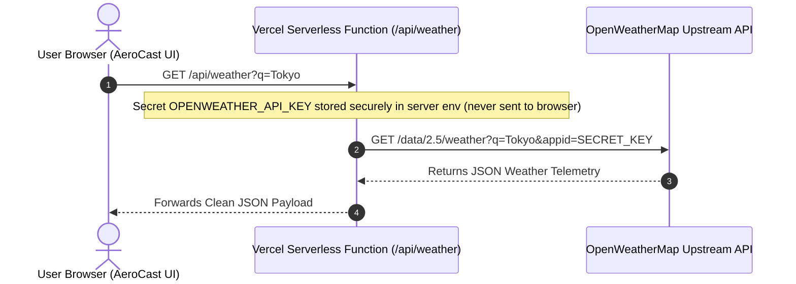

# AeroCast — Real-Time Weather Forecast & Climate Telemetry Dashboard

[](https://datheon.in)
[](#)
[](https://vitejs.dev/)
[](#)
[](https://openweathermap.org/api)

> A production-grade, responsive real-time meteorological observation and climate telemetry web application built for the **Datheon Full Stack Web Development Internship — Task 3**.

---

## 🌟 Live Demo & Preview Features

AeroCast connects directly to the OpenWeatherMap REST API to deliver atmospheric telemetry and a synchronized 5-day forecast with contextual dynamic themes, smooth glassmorphic interface, and zero fake data.

### ✨ Key Features Breakdown

#### 1. 🔍 Weather Search
- **Worldwide Coverage**: Search any city, municipality, or region across the globe.
- **Location Identification**: Displays city name, ISO country badge, full localized country name, and geographical coordinates (Latitude/Longitude).
- **Core Metrics**: Real-time current temperature, apparent feels-like temperature, and meteorological condition description.
- **Dynamic Weather Icons**: Custom high-definition vector SVGs with condition-specific animations and ambient lighting effects.

#### 2. 📊 Atmospheric Telemetry (Detailed Climate Metrics)
- **Wind Telemetry**: Speed in km/h or mph, 16-point cardinal direction (e.g. `WSW`, `ENE`), degrees, wind gust records, and an interactive rotating 360° compass dial.
- **Humidity & Moisture**: Relative humidity percentage, live visual bar, comfort rating (*Dry*, *Comfortable*, *High*), and estimated Dew Point calculated using the Magnus formula.
- **Atmospheric Pressure**: Barometric reading in hPa, standard atmospheric comparison (1013 hPa), and analog scale indicator (*Low/Stormy*, *Standard*, *High/Fair*).
- **Horizontal Visibility**: Visual clarity in kilometers or miles with qualitative assessments (*Optimal*, *Good*, *Moderate*, *Poor*).
- **Solar Astronomical Cycle**: Sunrise and sunset times computed strictly in the **queried city's local timezone** (using `city.timezone` seconds offset), daylight duration counter, and a celestial arc showing the sun's trajectory.
- **Cloud Cover**: Cloudiness percentage bar and sky condition categorization.

#### 3. 📅 5-Day Extended Forecast (Calendar-Day Grouping)
- **Calendar-Day Aggregation**: Automatically transforms OpenWeatherMap's 40-step 3-hour raw intervals into **5 clean calendar days**, correctly offset to the queried city's local clock.
- **Daily Extremes**: Accurately computes true minimum and maximum diurnal temperatures across all 3-hour samples for each day.
- **Representative Conditions**: Selects the midday condition and representative SVG icon for each forecast day.
- **Visual Range Bars**: Proportional temperature bars highlighting daily min/max variance relative to the 5-day cycle.

#### 4. ⚡ Modern Architecture & API Integration
- **Modern JavaScript**: Clean modular ES6+ architecture with `async/await` and Native Fetch API.
- **Concurrent Retrieval**: Uses `Promise.all` to fetch real-time weather and 5-day forecast simultaneously in a single roundtrip.
- **Robust Error Handling**:
  - `401 Unauthorized`: Actionable invalid key banner with quick-access configuration modal.
  - `404 Not Found`: City not found guidance with format recommendations (e.g., `"City, Country"`).
  - `429 Too Many Requests`: Rate limit notifications.
  - `Offline / Network Failures`: Intercepts connection drops gracefully without crashing.
- **Loading Telemetry**: Shimmering skeleton cards and spinning telemetry gauge during network latency.

#### 5. 🎨 Dynamic Reactive UI & Aesthetics
- **Contextual Weather Themes**: Automatically switches page background gradients and ambient lighting based on atmospheric state:
  - ☀️ *Clear Sky (Day)*: Radiant solar azure & warm amber glow.
  - 🌙 *Clear Sky (Night)*: Deep celestial midnight indigo with starlight.
  - ☁️ *Clouds / Overcast*: Slate blue and silver mist.
  - 🌧️ *Rain / Showers*: Deep ocean storm blue with rain glimmer.
  - 🌦️ *Drizzle*: Muted morning mist blue.
  - ⛈️ *Thunderstorm*: Electric violet and storm charcoal with lightning flash simulation.
  - ❄️ *Snow*: Frosted arctic twilight and glacial blue.
  - 🌫️ *Atmosphere (Mist, Fog, Haze, Dust)*: Ethereal smoky teal.
- **Instant Unit Toggle**: Switch between **Celsius (°C)** and **Fahrenheit (°F)** instantly in-place without triggering another API call.
- **Device Geolocation**: Optional "Locate Me" button that detects GPS coordinates only after explicit user permission.
- **Search Memory**: Quick-access chips for popular world hubs (*London, Tokyo, New York, Paris, Sydney, Dubai*) and recently searched cities stored in `localStorage`.
- **Zero Fake Data Policy**: Clean initial welcome view with feature guide before any query is made; never renders placeholder mock temperatures as real.

---

## 📁 Project Directory Structure

```text
project-3-wether-app/
├── api/                           # Optional Vercel serverless proxy functions
│   ├── weather.js                 # Serverless endpoint for current weather
│   └── forecast.js                # Serverless endpoint for 5-day forecast
├── public/
│   └── favicon.svg                # Vector SVG favicon
├── src/
│   ├── scripts/
│   │   ├── api.js                 # OpenWeatherMap Fetch API client & error handler
│   │   ├── config.js              # Environment & localStorage key/unit manager
│   │   ├── main.js                # Application controller & event dispatcher
│   │   ├── ui.js                  # DOM renderer, telemetry gauges, views & modal
│   │   ├── weatherIcons.js        # Dynamic SVG weather icon generator
│   │   └── weatherUtils.js        # Conversions, local clock offset, 5-day grouping
│   └── styles/
│       ├── components.css         # Glass cards, buttons, compass, solar arc, modal
│       ├── main.css               # Design tokens, CSS variables, typography, reset
│       └── themes.css             # Dynamic weather condition gradients & glows
├── .env.example                   # Environment variable template
├── .gitignore                     # Git ignore rules for node_modules, .env, dist
├── index.html                     # Semantic accessible HTML5 layout
├── package.json                   # Project scripts and Vite dev dependency
├── vercel.json                    # Vercel deployment build & routing configuration
├── vite.config.js                 # Vite bundler configuration
└── README.md                      # Comprehensive project documentation
```

---

## 🚀 Local Development Setup

### Prerequisites
- [Node.js](https://nodejs.org/) (version `18.0.0` or higher recommended)
- `npm` or `pnpm` / `yarn`

### Installation Steps

1. **Clone or Navigate to the Project Directory**:
   ```bash
   cd project-3-wether-app
   ```

2. **Install Dependencies**:
   ```bash
   npm install
   ```

3. **Configure Environment Variables**:
   Copy `.env.example` to `.env`:
   ```bash
   # On Windows (cmd)
   copy .env.example .env

   # On macOS / Linux
   cp .env.example .env
   ```

   Open `.env` and insert your OpenWeatherMap API key:
   ```env
   VITE_OPENWEATHER_API_KEY=your_actual_32_character_api_key_here
   ```

4. **Start Local Development Server**:
   ```bash
   npm run dev
   ```
   Open your browser at `http://localhost:3000` (or the URL displayed in the terminal).

5. **Build for Production**:
   ```bash
   npm run build
   ```
   The production-ready assets will be compiled into the `dist/` directory.

6. **Preview Production Build**:
   ```bash
   npm run preview
   ```

---

## 🔑 Obtaining & Configuring Your OpenWeatherMap API Key

AeroCast requires a valid OpenWeatherMap API key to fetch live telemetry. OpenWeatherMap offers a **Free Tier** that includes 60 calls/minute and 1,000,000 calls/month at zero cost.

### Step-by-Step Guide

1. Visit [https://home.openweathermap.org/users/sign_up](https://home.openweathermap.org/users/sign_up) and create a free account.
2. Confirm your email address through the verification link sent by OpenWeatherMap.
3. Log in and navigate to the **API Keys** tab in your account dashboard ([https://home.openweathermap.org/api_keys](https://home.openweathermap.org/api_keys)).
4. You will see a `Default` 32-character key already created (or you can generate a new one with a custom name).
5. Copy the 32-character hexadecimal key.

> ⚠️ **Important Notice on Activation Time:**
> Newly created OpenWeatherMap API keys typically require **10 to 30 minutes** to propagate through their global API gateway. If you see an `HTTP 401 Unauthorized` immediately after creating a key, wait a few minutes and try again.

### Configuring the Key in AeroCast

You can provide the key using either of two methods:

- **Method A: Via `.env` (Recommended for Local Dev & Vercel)**
  Set `VITE_OPENWEATHER_API_KEY=your_key_here` in your local `.env` file. Vite will automatically inject it during development and bundling.

- **Method B: Via the In-App Key Dialog (Instant Browser Testing)**
  Click the **API Key** button in the top-right header of the running application. Paste your key and click **Save & Apply**. The key is saved locally in your browser's `localStorage` and never transmitted to any third-party server.

---

## 🌐 Deploying to Vercel

AeroCast is optimized for seamless zero-configuration deployment to [Vercel](https://vercel.com/).

### Method 1: Deploy via Vercel Web Dashboard (Recommended)

1. Push your repository to GitHub, GitLab, or Bitbucket (make sure `.env` is **not** committed; `.gitignore` is already pre-configured).
2. Log into your [Vercel Dashboard](https://vercel.com/dashboard).
3. Click **Add New...** -> **Project**.
4. Import your `project-3-wether-app` repository.
5. In the **Configure Project** screen:
   - **Framework Preset**: `Vite` (Vercel auto-detects this).
   - **Root Directory**: `./` (leave default).
   - **Build Command**: `npm run build` (auto-detected).
   - **Output Directory**: `dist` (auto-detected).
6. Under **Environment Variables**, add:
   - **Key**: `VITE_OPENWEATHER_API_KEY`
   - **Value**: Your 32-character OpenWeatherMap API key.
7. Click **Deploy**. Vercel will build the project and provide a live `*.vercel.app` URL within seconds!

### Method 2: Deploy via Vercel CLI

```bash
# 1. Install Vercel CLI globally if not already installed
npm i -g vercel

# 2. Login to Vercel
vercel login

# 3. Deploy
vercel

# 4. Set environment variable on Vercel
vercel env add VITE_OPENWEATHER_API_KEY
# (paste your key and select Production, Preview, Development)

# 5. Deploy to production
vercel --prod
```

---

## 🛡️ Production Security & API Key Best Practices

### Understanding Client-Side API Keys

In a pure client-side Single Page Application (SPA), any environment variable prefixed with `VITE_` is baked into the compiled JavaScript bundle (`dist/assets/*.js`) during build time. This means anyone inspecting browser network traffic or source bundles can view the key.

For simple portfolio projects, OpenWeatherMap free-tier keys are common practice because they have built-in rate limits (60 requests/minute). However, **for high-security or enterprise production systems**, exposing raw keys is not recommended.

### Secure Production Architecture: Serverless Proxy

To demonstrate full-stack engineering best practices, this repository includes an optional serverless reverse proxy located in `api/`:
- [`api/weather.js`](api/weather.js) — Proxies `/weather` queries.
- [`api/forecast.js`](api/forecast.js) — Proxies `/forecast` queries.

#### How It Works:


In this architecture:
1. The client browser only calls `/api/weather?q=Tokyo`.
2. The Vercel Serverless Function reads `process.env.OPENWEATHER_API_KEY` strictly on the server side.
3. The API key is **never visible** in the client's browser developer tools, preventing unauthorized quota consumption or key scraping.

---

## 🧪 Verification & Build Status

The project was compiled and verified using Vite:
```bash
> npm run build
vite v6.4.5 building for production...
✓ 11 modules transformed.
dist/index.html                 26.25 kB
dist/assets/index-BuSz46UJ.css  33.05 kB
dist/assets/index-D52mjYkA.js   40.61 kB
✓ built in 333ms
```

---

## 👨‍💻 Author & Acknowledgments

- **Internship**: Datheon Full Stack Web Development Internship — Task 3
- **Developer**: Full Stack Web Development Intern
- **Data Provider**: [OpenWeatherMap API](https://openweathermap.org/)
- **License**: MIT

